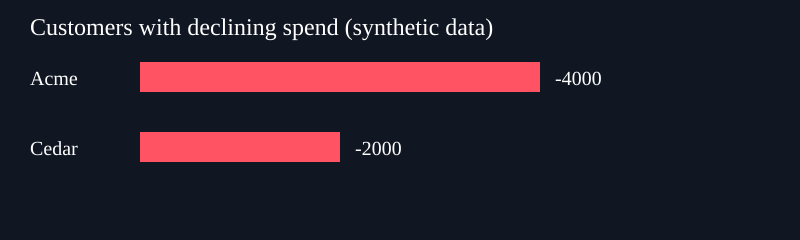

# Demo 2: TanStack AI + Docker Sandboxes (sbx microVM)

Run JavaScript in a **real Docker microVM** using TanStack AI's `sbxSandbox()` provider. Compare two synthetic sales exports, generate an Excel workbook and chart, and demonstrate an explicit network denial.

Built for the CityJS talk on MCP security and JavaScript sandboxes.



## What happens

1. Prepare a temporary Git repository containing only the synthetic CSVs and report code.
2. Create a Docker Sandbox through `sbxSandbox()`.
3. Install ExcelJS inside the VM and execute `report.cjs`.
4. Verify the comparison: Acme drops by 4,000; Cedar drops by 2,000.
5. Verify that a synthetic file outside the cloned repository is inaccessible at its host path.
6. Request `https://example.com`, explicitly denied for this sandbox, and check HTTP **403**.
7. Retrieve generated files through TanStack's `sandbox.fs.readBytes()` API.
8. Remove the demo VM and temporary input repository.

**Scope:** this is a working sandbox provider integration, not an autonomous model-driven `chat()` / `withSandbox()` agent. The report program is supplied in the repository. No model API key is needed. The SVG chart is a separate file, not an embedded Excel chart.

## Requirements

- Node.js 22+ and npm.
- Git on the host.
- [Docker Sandboxes](https://docs.docker.com/ai/sandboxes/) (`sbx`) installed and signed in with `sbx login`.
- A supported hypervisor: Virtualization.framework, Hyper-V, or KVM. A Docker socket alone is insufficient.
- An initialized Docker Sandbox network policy and a shell template. Start with `sbx diagnose` and `sbx ls` to check your installation.

Tested on macOS with Docker sbx **0.49.1** and `@tanstack/ai-sandbox-docker` **1.0.0**. Other platforms have not been tested.

## Run

```bash
git clone https://github.com/shivaylamba/tanstack-docker-sandbox-demo.git
cd tanstack-docker-sandbox-demo/demo-2-codex
npm ci
npm run demo
```

If you have no cached shell template, permit the first image download:

```bash
SBX_PULL_POLICY=missing npm run demo
```

By default the wrapper uses `--pull never` to avoid image refreshes during a conference demo. Dependency installation still needs the npm registry. The first run can take several minutes; subsequent VM creation uses the cached template.

Success ends with:

```text
HOST_MARKER_NOT_VISIBLE
403
EXPORTED sales-report.xlsx: ... bytes
EXPORTED spending-drop.svg: ... bytes
EXPORTED result.json: ... bytes
TANSTACK_SBX_DEMO_OK
Demo sandbox removed.
```

Generated files are saved in `artifacts/`, which is ignored by Git. See [sample workbook](examples/sales-report.xlsx) and [sample results](examples/result.json) for outputs from the original live run.

## Present it live: two terminals

In the first terminal:

```bash
npm run demo:live
```

This runs the checks, then holds an attached in-VM process while waiting for Enter (up to one hour). The script prints the exact commands for the second terminal, including its unique sandbox name:

```text
sbx ls
sbx exec <printed-sandbox-name> -- sh -lc 'uname -s; node --version; cat result.json'
sbx policy log <printed-sandbox-name> --limit 10
```

Show the running VM, Linux/Node runtime, calculated results, and `example.com` denial in the policy log. Press **Enter in the first terminal** to remove the VM. If interrupted or your terminal closes unexpectedly, inspect `sbx ls` and remove only the demo sandbox with `sbx rm --force <printed-sandbox-name>`.

Suggested narration:

> TanStack created this Docker microVM, installed an npm package, executed JavaScript, and retrieved the generated files. Here is the running environment and the network policy log.

## The integration

```js
import { sbxSandbox } from '@tanstack/ai-sandbox-docker'

const provider = sbxSandbox({
  workspaceDir: temporaryGitRepository,
  allowNetwork: ['registry.npmjs.org'],
  denyNetwork: ['example.com'],
  cpus: 2,
  memory: '2g',
})

const sandbox = await provider.create({ id: 'your-unique-demo-id' })
try {
  const result = await sandbox.process.exec('node report.cjs')
  const workbook = await sandbox.fs.readBytes('sales-report.xlsx')
} finally {
  await sandbox.destroy()
}
```

The full [demo.mjs](demo.mjs) adds the CLI compatibility wrapper, automatic fixture creation, checks, exports, and live-inspection mode.

## Compatibility wrapper

TanStack's published 1.0.0 provider invokes `sbx create --quiet`; sbx 0.49.1 rejects that flag. [sbx-compat](sbx-compat) checks the installed CLI help and translates it to `--no-progress` when necessary. It delegates to the real `sbx` on `PATH`; it does not simulate a sandbox or modify the installation.

You can override the executable with `SBX_REAL_BINARY=/path/to/sbx` and image policy with `SBX_PULL_POLICY=missing`. A Git repository is mandatory because the provider uses `sbx create --clone`.

## Security boundaries

- Inputs are synthetic. The temporary input repo contains only the fixture files, not this project's `node_modules`, environment files, or credentials.
- Scoped allow rules **do not narrow inherited global allows**. This demo uses your existing machine policy plus an explicit deny for `example.com`; it does not prove npm is the only reachable host.
- The provider may add access for localhost tool bridging. A bridged host tool still needs its own authentication and tenant authorization.
- The host marker and HTTP denial are narrow observable checks, not a sandbox escape assessment.
- Docker login and model-provider login are separate. This demo requires only Docker login.
- Package installation is pinned at the top level and disables install scripts. Transitive dependencies inside the VM are resolved at install time; this is a conference demo rather than a production dependency policy.

## Troubleshooting

| Symptom | Action |
| --- | --- |
| `ERR_MODULE_NOT_FOUND` | Run `npm ci` inside this repository. |
| Docker session expired / DNS lookup failure | Restore connectivity, retry `sbx ls`, then run `sbx login` if needed. |
| Missing cached template | Use `SBX_PULL_POLICY=missing npm run demo`. |
| Machine policy is Open | The provider cannot enforce an allowlist on Open. Configure your policy intentionally; this demo never resets global policy for you. |
| No available hypervisor | Enable supported virtualization. Standard Docker containers alone cannot run this provider. |

## Sources

- [TanStack provider details](https://tanstack.com/ai/latest/docs/sandbox/providers-advanced)
- [TanStack sandbox quick start](https://tanstack.com/ai/latest/docs/sandbox/quick-start)
- [TanStack host tool bridge](https://tanstack.com/ai/latest/docs/sandbox/tools)
- [Docker Sandbox isolation](https://docs.docker.com/ai/sandboxes/security/isolation/)
